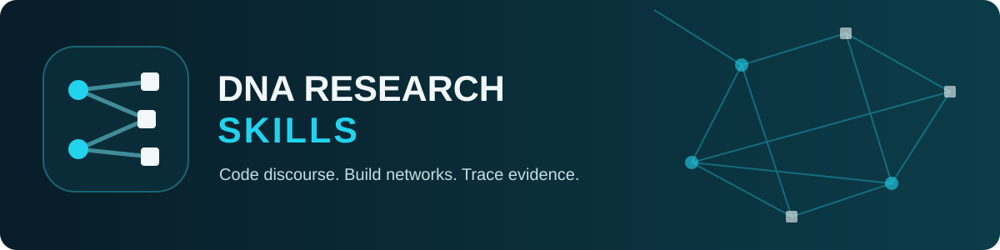
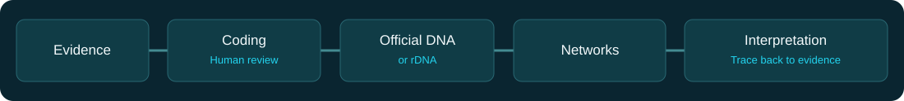

<p align="center"></p>

# DNA Research Skills

**Version 0.1.0 Technical Preview**

**An independent research assistant for Discourse Network Analysis.** Code discourse. Build networks. Trace evidence.

This project helps a researcher prepare evidence, review propositions, use the official DNA/rDNA tools and document network analyses. It is based on work by Philip Leifeld and contributors. It is not affiliated with or endorsed by Leifeld Lab. This release is a **technical preview**: the Python validation utilities have focused tests; the R bridge has not yet been run against installed DNA/rDNA. See [limitations](#limitations).



## Quick start

1. Review the [installation guide](docs/INSTALLATION.md) and [security notes](docs/SECURITY.md).
2. Open this repository with a compatible agent and ask: `Use dna-research to inspect this environment and plan a discourse network study.` OpenCode can discover the project-local skill. Other clients may need a copy of the skill folder; see [adapters](adapters/).
3. Or run these commands from the repository root:

```sh
python3 .agents/skills/dna-research/scripts/dna_tool.py discover
python3 .agents/skills/dna-research/scripts/dna_tool.py validate-corpus examples/synthetic-case/corpus.csv
python3 .agents/skills/dna-research/scripts/dna_tool.py validate-statements examples/synthetic-case/statements.csv --corpus examples/synthetic-case/corpus.csv --codebook examples/synthetic-case/codebook.json
```

The examples are fictional and do not produce network results. See [workflow](docs/WORKFLOW.md) for the nine stages and [analysis notes](.agents/skills/dna-research/references/analysis.md) for the R bridge.

## Supported agents

The skill follows the [Agent Skills specification](https://agentskills.io/specification). Project-local discovery is documented by [OpenCode](https://opencode.ai/docs/skills/). See platform guides in [adapters](adapters/). Availability, paths and tool permissions depend on the installed agent and its version. No slash command is assumed. The agent runs in its own host environment, which can be a remote computer.

## Environment

The first check is read-only. Java, R, rJava, rDNA, DNA and optional visualization tools are detected where possible. Absence outside the limited search is unknown. The researcher chooses whether and where to install software; no automatic installation or uploads. A private root such as the actual Documents folder plus `DNA_Tools` is recommended, with `projects/<project-id>` and `output/<project-id>` underneath. The init command creates these paths only when invoked explicitly. It takes an explicit root to handle redirected Documents folders safely.

## Method and traceability

Define the corpus and chronology, map sources, discover related evidence, clean a working copy, propose and review statements, define episodes, use official DNA/rDNA and interpret results against evidence. A source reproducing a statement is not necessarily an independent statement. Actor-concept links are discourse relations, not direct interactions. A discourse network does not on its own establish virality, exposure or causation. AI suggestions are candidates until a researcher checks them.

Statuses `AI_CANDIDATE`, `HUMAN_VALIDATED`, `DNA_EXECUTED`, `EXTERNALLY_COMPUTED`, and `VISUALIZED` refer to distinct stages. A label alone is not evidence. Preserve parameters, software versions, identifiers, checksums and decisions.

## Limitations

- The R bridge follows the official 3.1.2 source but requires end-to-end verification with a local synthetic DNA database. It has not run in the release environment.
- No automatic import of statements to DNA, no automatic validation of human approval inside a database, and no automatic claim of DNA execution.
- Structural checks do not establish factual accuracy, interpretive agreement, legal access or completeness. GraphML checks do not prove correct scientific semantics or visualization.
- Windows and macOS require local checks. The dissertation and private data are not bundled. Review the release report before use.

## Academic references

Leifeld, P. (2017). Discourse network analysis: Policy debates as dynamic networks. In J. N. Victor, M. N. Lubell, & A. H. Montgomery (Eds.), *The Oxford handbook of political networks* (pp. 301–326). Oxford University Press. https://doi.org/10.1093/oxfordhb/9780190228217.013.25

Leifeld, P. (2020). Policy debates and discourse network analysis: A research agenda. *Politics and Governance, 8*(2), 180–183. https://doi.org/10.17645/pag.v8i2.3249

Software: [Discourse Network Analyzer and rDNA](https://github.com/leifeld-lab/dna), developed by Philip Leifeld and contributors. See the upstream repository for authorship and licenses.

## License

Original content is MIT licensed. The project does not redistribute DNA or rDNA. Upstream code and binaries have separate licenses and restrictions; see [third-party notices](THIRD_PARTY_NOTICES.md). Simple English principles guide the prose without reproducing the third-party project.
